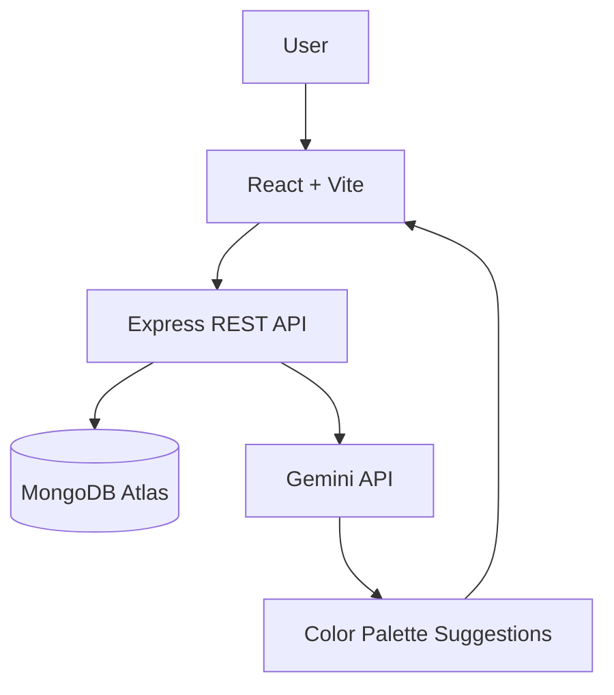

# 🎨 AI Coloring Studio

A full-stack web application to explore coloring pages, color illustrations, save artwork, and get AI-powered color palette suggestions.

Built using the MERN stack to practice full-stack development, automated testing, and CI/CD.

## ✨ Features

- 🔐 User registration and login with JWT authentication
- 🔎 Browse and search coloring pages by category and difficulty
- 🎨 Interactive coloring canvas with color picker, Fill, Eraser, Undo, Redo, and Reset
- 🖼️ Save, edit, and delete artwork
- 🗂️ Personal artwork gallery
- 🤖 AI-powered color palette suggestions with fallback palettes
- 🧪 Automated backend and frontend tests
- ⚙️ GitHub Actions CI/CD for automated testing and builds

## 🛠️ Tech Stack

| Layer | Technologies |
|---|---|
| Frontend | React, Vite, JavaScript, CSS |
| Backend | Node.js, Express.js |
| Database | MongoDB Atlas, Mongoose |
| Authentication | JWT, bcryptjs |
| AI | Google Gemini API |
| Testing | Node.js Test Runner, Vitest, React Testing Library |
| CI/CD | GitHub Actions |

## 🏗️ Architecture



## 📁 Project Structure

```text
ai-coloring-studio/
├── .github/workflows/
│   └── ci.yml
├── client/
│   ├── public/coloring-pages/
│   └── src/
│       ├── components/
│       ├── pages/
│       ├── services/
│       └── __tests__/
├── server/
│   ├── controllers/
│   ├── models/
│   ├── routes/
│   ├── middleware/
│   └── tests/
└── README.md
```

## 🚀 Getting Started

**Prerequisites:** Node.js and npm.

Clone the repository:

```bash
git clone https://github.com/NishaPanda/ai-coloring-studio.git
cd ai-coloring-studio
```

Start the backend in one terminal:

```bash
cd server
npm install
npm run dev
```

Start the frontend in a second terminal:

```bash
cd client
npm install
npm run dev
```

Open the frontend at **http://localhost:5173**.

## 🧪 Testing

Run backend tests:

```bash
cd server
npm test
```

Run frontend tests:

```bash
cd client
npm test
```

Build the frontend:

```bash
npm run build
```

**Latest verified results:** 28 backend tests passed, 14 frontend tests passed, and the production build succeeded.

## ⚙️ CI/CD

GitHub Actions automatically runs backend tests, frontend tests, and the frontend production build on pushes to `main` and pull requests targeting `main`.

[View GitHub Actions](https://github.com/NishaPanda/ai-coloring-studio/actions)


## 📌 Project Roadmap

| Phase | Description | Status |
|---|---|---|
| Phase 1 | Project Setup | ✅ Complete |
| Phase 2 | Basic Application Structure | ✅ Complete |
| Phase 3 | Authentication | ✅ Complete |
| Phase 4 | Interactive Coloring Studio | ✅ Complete |
| Phase 5 | Coloring Pages & Browse | ✅ Complete |
| Phase 6 | Artwork & Gallery | ✅ Complete |
| Phase 7 | AI Color Suggestions | ✅ Complete |
| Phase 8 | Automated Testing | ✅ Complete |
| Phase 9 | CI/CD with GitHub Actions | ✅ Complete |
| Phase 10 | Deployment | ⬜ Pending |


## 🔮 Future Improvements

- Polish the UI with a modern, responsive design.
- Deploy the application.
- Expand test coverage and add new coloring features.
